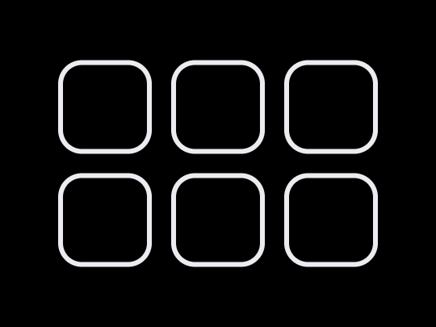
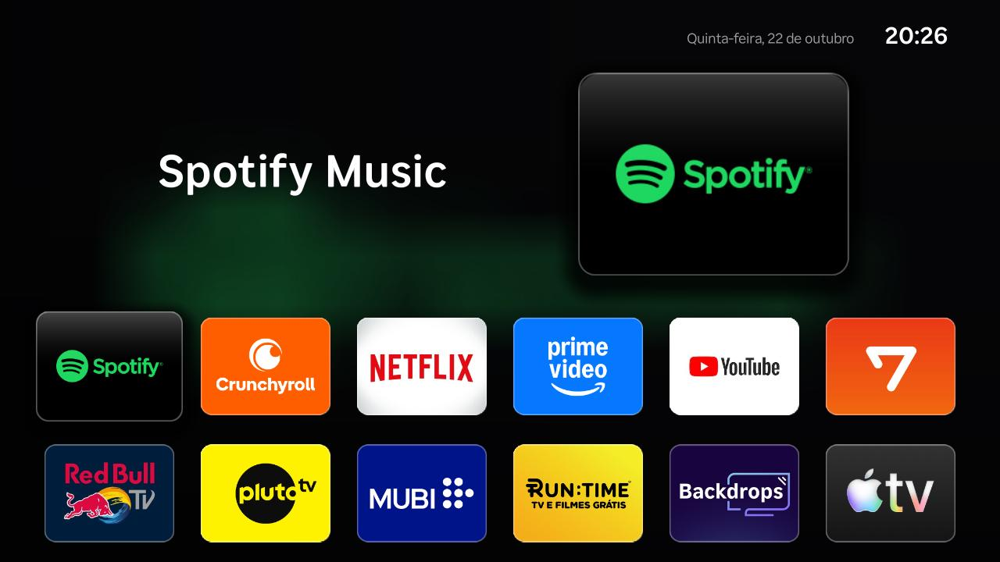
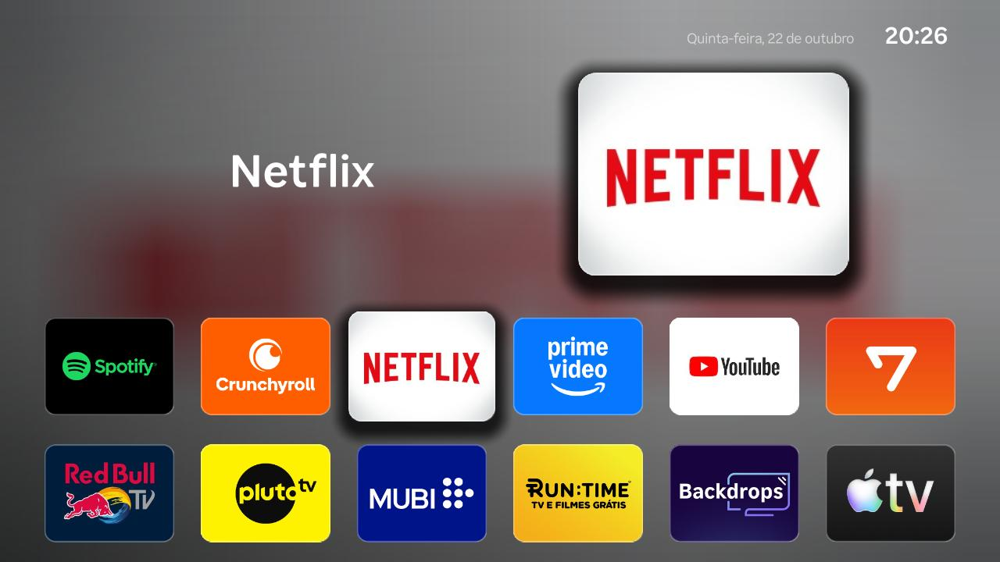
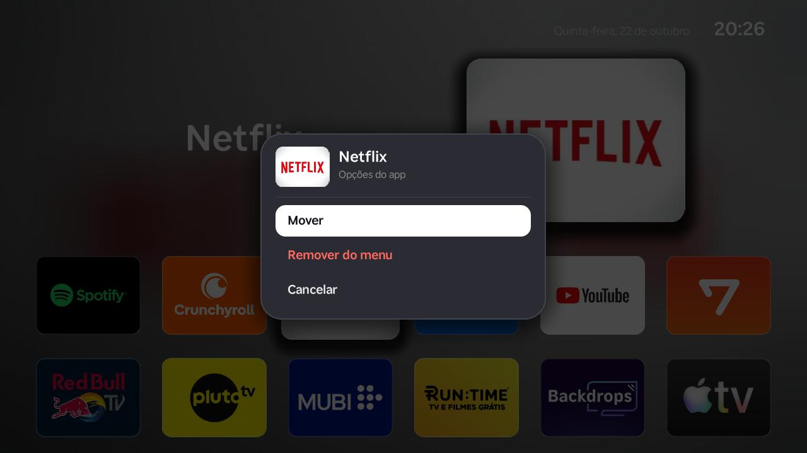
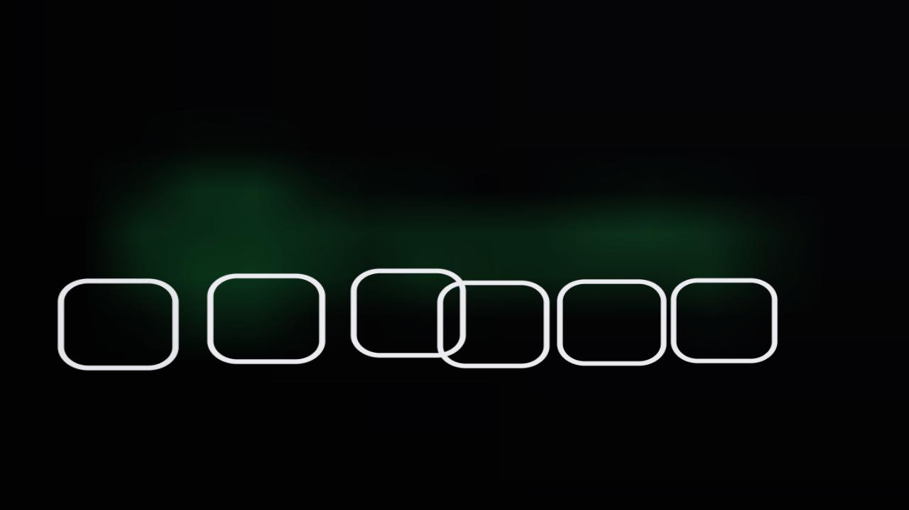
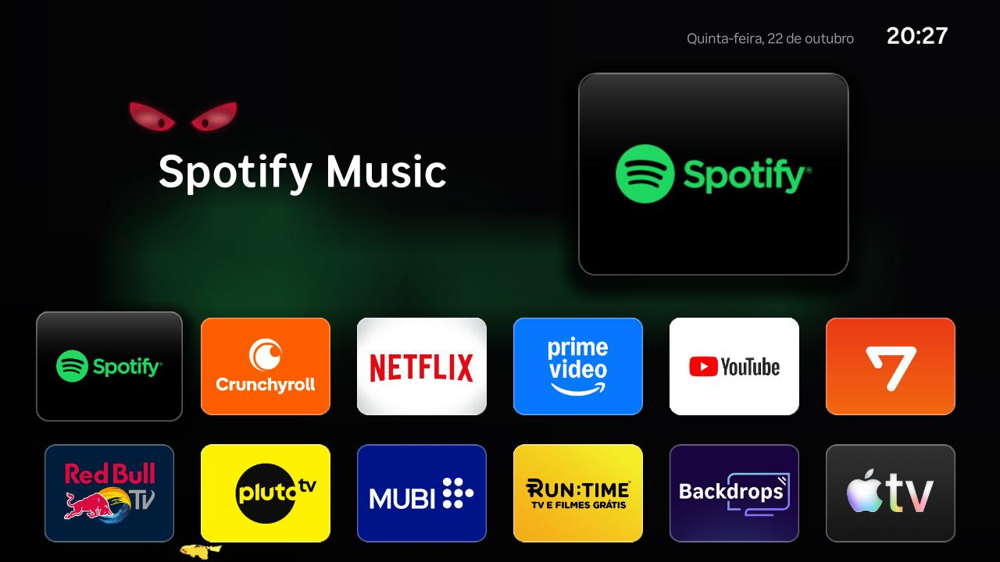

<p align="center"></p>

# Meu Menu (Roku launcher)

Tela inicial personalizada, no estilo Apple TV, para **Roku TV** (testado numa AOC 32" com Roku OS 15.3.4).
É instalada como app de desenvolvedor (sideload) e abre automaticamente quando a TV liga.



## Telas

| Destaque com a cor do app em foco | Painel de opções (tecla ✱) |
|---|---|
|  |  |
| **Abertura animada**: os quadradinhos voam até a grade | **Mascotes**: olhos do Gengar no fundo e Pikachu correndo embaixo |
|  |  |

## Recursos
- Destaque com prévia do app, fundo com a cor do app em foco, ícones arredondados com sombra e brilho
- Abertura animada: os quadradinhos da tela de abertura voam até a grade e viram os ícones
- Tecla ✱: mover apps (ordem personalizada), remover do menu, restaurar apps removidos
- Mascotes: olhos do Gengar no fundo, Pikachu correndo e Rimuru slime pulando pela borda de baixo
- Lista de apps atualizada automaticamente quando um app é instalado ou removido na TV

## Como funciona
A Roku não deixa um app listar nem abrir outros pela rede local (ECP responde 403 de dentro do app),
então um serviço no PC (`tools/servico_tv.py`) faz a ponte:
- lê os apps e ícones da TV e grava em `app/source/apps.json` / `app/images/apps/`
- reinstala o app quando a lista muda (só com o Meu Menu na tela ou ao ligar a TV)
- abre o Meu Menu quando a TV liga na tela inicial

Os apps são abertos de dentro do menu com `roAppManager.LaunchApp`.

## Configuração

### Requisitos
- Roku TV (ou player) e o PC na **mesma rede local**
- Python 3 no PC (e Pillow, só se for gerar os mascotes)
- Conta em developer.roku.com só é necessária para **publicar** na Channel Store; para uso pessoal (sideload) não precisa

### 1. Ativar o Modo Desenvolvedor na TV
1. Na tela inicial, com o controle remoto, digite:
   **Home ×3 → Cima ×2 → Direita → Esquerda → Direita → Esquerda → Direita**
2. Abre a tela **Developer Settings**. Anote o **endereço IP** da TV (ex.: `192.168.0.25`)
3. Selecione **Enable installer and restart** e aceite a licença (**I Agree**)
4. Crie uma **senha** para o servidor de desenvolvimento e confirme. A TV reinicia

> Dica: o IP também aparece em Configurações → Rede → Sobre. Reserve um IP fixo para a TV no roteador para ele não mudar.

### 2. Liberar o controle pela rede
Em Configurações → Sistema → Configurações avançadas → Controle por apps móveis → Acesso à rede: **Padrão**.
Sem isso o serviço do PC não consegue ler os apps nem abrir o Meu Menu (a TV responde 403).

### 3. Configurar o PC
1. Copie `tools/config.exemplo.json` para `tools/config.json` e preencha:
   ```json
   {
    "tv_ip": "192.168.0.25",
    "dev_user": "rokudev",
    "dev_password": "A_SENHA_QUE_VOCE_CRIOU"
   }
   ```
   O usuário é sempre `rokudev` (não é o seu e-mail).
2. Teste o acesso: abra `http://IP_DA_TV` no navegador e entre com `rokudev` e a senha. Deve aparecer o **Development Application Installer**

### 4. Instalar o app
- **Pelo navegador (manual):** na página do instalador, clique em **Upload**, escolha `meu-menu.zip` e depois **Install** (ou **Replace**, se já estiver instalado)
- **Automático:** o serviço do PC reinstala sozinho quando a lista de apps muda

### 5. Instalar o serviço (abrir ao ligar a TV)
```bash
mkdir -p ~/.config/systemd/user
cp tools/roku-meu-menu.service ~/.config/systemd/user/
# ajuste o caminho do ExecStart se a pasta não estiver em ~/Downloads/meu-menu
systemctl --user daemon-reload
systemctl --user enable --now roku-meu-menu
systemctl --user status roku-meu-menu
```

### Depuração
- **Console BrightScript:** `telnet IP_DA_TV 8085` mostra os `print` e os erros do app
- **Controle por rede (ECP):** `http://IP_DA_TV:8060` (por exemplo `/query/apps` lista os apps instalados)
- **Log do serviço:** `journalctl --user -u roku-meu-menu -f`

### Problemas comuns
| Sintoma | Causa provável |
|---|---|
| Página `http://IP_DA_TV` não abre | IP errado, ou PC e TV em redes diferentes |
| Login recusado | Usuário deve ser `rokudev`; confira a senha do Modo Desenvolvedor |
| Erro 403 ao ler apps | Acesso à rede está em "Desativado"/"Limitado"; troque para **Padrão** |
| Erro ao instalar o `.zip` | Pasta extra na raiz do zip ou `manifest` ausente |
| Sequência do controle não funciona | Digite mais devagar, começando pela tela inicial |
| App some depois de atualizar a TV | Reative o Modo Desenvolvedor e reinstale o `meu-menu.zip` |

## Estrutura
| Pasta/arquivo | Conteúdo |
|---|---|
| `app/` | Código do app Roku (BrightScript/SceneGraph) |
| `tools/servico_tv.py` | Serviço do PC (abrir ao ligar, atualizar a lista, instalar) |
| `tools/gerar_*.py` | Geram ícone, imagens da interface e mascotes (requer Pillow para os mascotes) |

## Créditos
Animação do Pikachu: GIF de [gifdb.com](https://gifdb.com/gif/pokemon-pikachu-running-fdcgna00aeogxcjz.html) (fundo removido).
Pokémon e Rimuru pertencem aos seus respectivos donos; uso pessoal.
